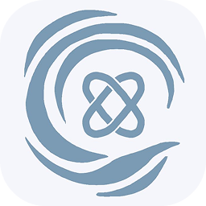

# Cove Browser

**Browse with calm.**

A free, open-source desktop browser built to stay out of your way. No bloat, no noise — just the web.

[Website](https://corestudios.web.app/cove.html) · [Download](https://github.com/corestudios-official/cove/releases/latest) · [Installation Guide](INSTALL.md)

---

## About

Cove is a desktop browser for Windows built with Electron and React. It's designed around one idea — that a browser should stay out of your way. No telemetry, no tracking, no account required. Everything stays on your device.

## Open Source

Cove is free to download, free to use, and open source. The full source code is here on GitHub.

## Built With

- [Electron](https://www.electronjs.org/) · [React](https://react.dev/) · [Chromium](https://www.chromium.org/)

## Acknowledgements

Built with the help of [Claude](https://claude.ai) (Anthropic) and [Windsurf](https://codeium.com/windsurf) (Codeium).

## License

MIT — see [LICENSE](LICENSE)